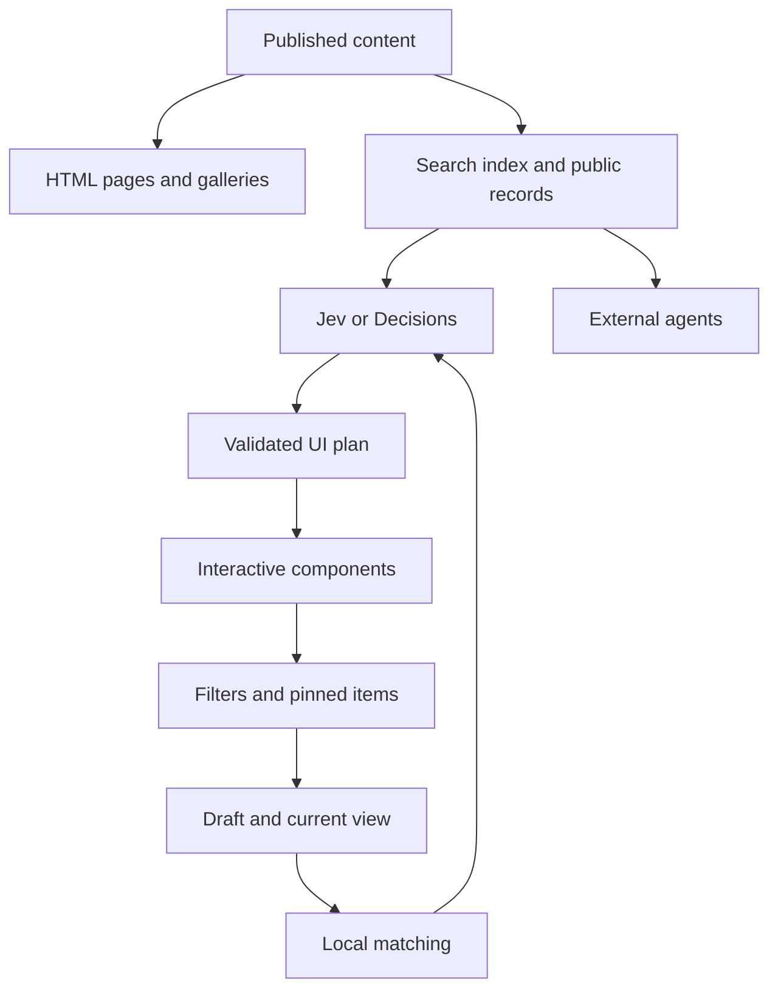

# Isaac Seiler Agent First Website Plan

Build a personal website that demonstrates Isaac’s developer skills, innovative UI design, and AI fluency through the experience itself. Its signature feature is a beautiful live canvas that adapts to a human visitor’s intent after a few words, while external agents can retrieve the same verified work through structured interfaces. Preserve the black background, Satoshi typography, restrained accents, and a substantial conventional photography gallery directly below the frame.

The architecture has three parts: a fast model interprets the visitor’s intent; a deterministic renderer composes interactive views from approved content; ordinary HTML pages and structured records expose the same material to search engines and visiting agents. There is no chatbot response layer, message transcript, or generated prose answer. Text inside components comes from published copy, verified facts, and concise interface labels.

Prepared for Isaac Seiler on October 20, 2026. This is a product and implementation plan; the production site has not been changed.

## Product goals

The primary goal is for visitors to experience Isaac’s ability to design and build a visually impressive, original AI-native product. A few words should change the composition, information hierarchy, and available controls in a way that feels tailored to this visit. Demonstrate interaction invention, art direction, semantic understanding, and reliable engineering together. The experience should make that capability evident before a visitor opens the technical explanation. Keep the inferred task correctable and avoid silently assigning a permanent persona.

Success means a first-time visitor can try a short request, see a genuinely useful interface transformation, and understand that the site is itself an example of Isaac’s work. A technical visitor can inspect how it was built and verify implementation evidence. Recruiters and collaborators can explore relevant projects; photography visitors can browse conventionally; connected agents can retrieve accurate, source-linked records.

Prioritize these outcomes in order:

1. Demonstrate developer skill, innovative UI design, and AI fluency through a distinctive, working type-to-transform experience.

2. Deliver memorable visual transformations with beautiful composition, purposeful motion, and useful controls after minimal input.

3. Keep photography prominent directly below the frame, with a complete conventional browsing experience.

4. Make the underlying work and engineering verifiable through sources, a build case study, and structured agent access.

5. Preserve accessible navigation, factual accuracy, search visibility, and reliable performance throughout.

The launch demonstrates adaptive interfaces, state management, public content retrieval, and agent interoperability. Show those capabilities through useful interactions and inspectable evidence. Keep messaging, scheduling, private integrations, and autonomous external actions outside this website’s scope.

## What to retain from the current site

The live site resolves at [www.isaacseiler.xyz](https://www.isaacseiler.xyz/), rather than the spelling in the initial message. The homepage and [photography page](https://www.isaacseiler.xyz/photos) were inspected.

| Existing element | Treatment |
| --- | --- |
| Black background and near-white text | Retain as the foundation |
| Satoshi typeface | Retain, with a clearer hierarchy for input, component headings, captions, and metadata |
| Large black-and-white portrait | Keep as a smaller identity anchor in the initial frame and a prominent image on About |
| Small green location indicator | Retain as a restrained accent; avoid implying Isaac is online |
| IIS monogram | Keep alongside clearer navigation |
| Two-eye floating AI pill | Reuse its visual character inside the main frame, as a small UI activity indicator |
| Work filters and individual project URLs | Preserve the content and routes; extend filtering through natural-language input |
| Large photo tiles and geographic collections | Keep the visual weight and familiar browsing behavior |
| Contact, LinkedIn, and GitHub links | Keep as ordinary links available throughout the site |

The existing projects provide useful starting material: the state government AI index, congressional office work, Taiwan AI literacy, journalism research, the Boehringer Cares rebrand, and OpenAI product feedback. Import their current page content before generating summaries; titles alone do not establish responsibilities or outcomes.

The photo index currently includes 16 named collections, including Taiwan, Matsu, Japan, Mongolia, Kazakhstan & Kyrgyzstan, Iceland, Australia, New Zealand, and Washington State. Preserve all existing collections and their editorial order.

The supplied [Instinct reference](https://files.instinct.com/vwhulzunq2va-building-a-site-for-the-agentic?via=im) opens a wrapper whose embedded file reports “Site Unavailable,” including after a reload. Its contents remain an unresolved design input; no requirements below are attributed to it.

## Homepage layout

Use a centered layout with approximately 1,280–1,400 pixels of usable desktop width and generous outer margins.

| Position | Contents | Behavior |
| --- | --- | --- |
| Header | IIS, Work, Photos, About, Contact | Persistent, ordinary links; usable before JavaScript |
| Identity line | Isaac Seiler, a short approved description, Seattle | Visible text establishes whose site this is |
| Main frame | Intro, dynamic content canvas, command field | Primary interaction and focal point |
| Photography section | Selected photographs, album links, View all photos | Always present directly below the frame |
| Footer | Public contact, social links, For agents, content update date | Small and readable |

The main frame should occupy roughly 520–640 pixels on a typical desktop, adjusted to viewport height. Keep the photography heading and the start of the first image row near the initial fold where practical. Avoid a full-screen introduction that pushes all photos out of view.

On phones, use a compact initial frame, approximately 380–500 pixels when space permits, and keep a clear Photos link above it. When the keyboard opens, hold the input in view without shifting the entire page. Let visitors deliberately expand a detailed view.

The frame has three stable regions: a small identity/status row, a flexible content canvas, and an input anchored at the bottom. The canvas is a working interface that transforms in place. Provide Back, Reset, and optional pinned items for navigation; do not add message bubbles or conversation history. Keep the canvas bounded so exploration does not push photography farther down the homepage.

The initial canvas should immediately look like a finished product: a short approved introduction, a small portrait, one featured build, and a relevant secondary project. Include four low-effort entry points: “What I build,” “How this works,” “AI work,” and “Photography.” Shortcuts use the same state pipeline as typed requests. Suggested input placeholder: “A few words. Explore what interests you.” Include a quiet cue that the interface updates while typing. Do not run a simulated typing animation that could be mistaken for a live model response.

## What happens while someone types

Use one primary interaction: **type to transform the interface**. Live results are the actual experience, not a preview of a later chatbot answer.

Typing selects, filters, and composes existing content into usable views. Visitors can click cards, change filters, pin a project, open an album, or refine the view through more text. Enter is optional: it stabilizes the current view or immediately resolves the latest draft. It never produces a prose reply.

| Input | UI produced |
| --- | --- |
| “What you build” | Published builds with implementation details, demo links, and available source; feature this website once implemented |
| “How this works” | Interactive architecture view with the current input-to-layout path and links to the build case study |
| “AI policy” | Research-led composition combining the state index, related work, and original sources |
| “Taiwan” then “teaching” | A mixed work-and-photo overview becomes a focused education view with relevant evidence and controls |
| “Compare these” | Pinned projects become a useful side-by-side comparison |
| “Photography” | Image-led selection with album controls; the permanent gallery below stays stable |
| “Japan at night” | Matching photos when verified metadata supports them; otherwise a useful broader selection |
| “Contact” | Public contact card with ordinary links |

The experience should respond to meaning, not a small hardcoded list of keywords. A model can recognize related concepts such as “teaching people to use AI” and select the Taiwan education project. A local search index provides the immediate baseline and fallback.

An example sequence: “Tai…” keeps the current layout; “Taiwan…” offers work and photos; “Taiwan teaching…” emphasizes the education project; “Taiwan teaching and workshops…” adds an approved publication or activity record. The interface changes continuously; no generated narrative follows.

For complex input, compose multiple approved components: a comparison, project details, and source links. Support relational instructions such as “compare these,” “only recent work,” and “more photos” using the current view and pinned content as context. Interpretation should change layout and interactions, not merely return a different list of search results.

## Interaction rules

These are starting implementation values to tune through testing, not measured performance claims.

- Update local keyword and title matches immediately.

- Send a live-intent request after approximately 250–350 milliseconds of inactivity and enough meaningful input. Do not send a request for every keystroke.

- Allow at most two live requests per second, one in flight per visitor, and a bounded number per draft. Coalesce intermediate changes and process the newest draft.

- Wait for composition to finish when visitors use an input method editor.

- Attach a monotonically increasing revision to every request. Discard any response that does not match the latest draft and content version.

- Cancel superseded work when possible. Cancellation does not necessarily erase provider billing.

- Switch layout only when a new interpretation is sufficiently strong. Start with a 0.75 probability threshold and a 0.15 margin over the current interpretation, then calibrate on actual prompts.

- Require a short stable period before major changes. Uncertain drafts retain the current useful view or show two topic choices.

- Keep focused controls and hovered cards stable. Never move a target just as someone tries to click it.

- Preserve the input’s selection and caret. Never auto-navigate, or scroll the gallery because of a predicted intent.

- Clearing an uncommitted draft restores the last committed view, or the initial canvas if none exists. Back reverses a committed view change. Reset clears the view, filters, and pins. Explicit filters and pinned content persist through ordinary refinements.

- Provide Live UI on/off beside a plain explanation: “Live UI uses AI as you type.” With it off, local matching still works and Enter requests a UI update. Both modes render components rather than chatbot responses.

- Use a 150–220 millisecond transition for content changes; respect reduced-motion settings.

Treat in-progress interpretations as provisional without making submission necessary. On Enter, commit the latest validated view; if its revision is still pending, resolve that exact revision first. Start the next draft from that view’s content IDs, filters, and pinned items. Ignore responses for older drafts. Preserve view history as structured state, not a chat transcript.

## Components and visual design

Build a small component registry before connecting a model. Each component needs a stable key, a responsive layout, an accessible name, a loading state, an empty state, and ordinary links to its underlying content.

| Component | Purpose |
| --- | --- |
| Profile summary | Short biography with portrait and source |
| Project group | Two or three relevant projects with clear roles and outcomes |
| Project detail | A focused view of one project with links to evidence |
| Experience timeline | Dated, verified roles and activities |
| Comparison | Side-by-side evidence around a visitor’s requested criterion |
| Writing list | Published articles and research |
| Photo selection | Two to four real images with captions and album links |
| Source list | Visible references supporting the displayed facts |
| Contact card | Public contact information |
| Topic choices | Resolve ambiguity without guessing |
| Build overview | Implementation choices, actual contribution, live demo, source availability, and measured outcomes |
| Architecture view | Interactive authored diagram of this site’s actual data and UI flow |

Start with twelve approved components and four composition families: overview, focused detail, comparison, and image-led exploration. Treat these as responsive composition rules, not four fixed pages. Components can vary in hierarchy, span, density, content, and contextual controls within authored bounds. Add another composition only when real visitor tasks justify it. Fix typography, spacing, colors, radii, motion, and image treatment across every state. Application code renders the validated plan; do not execute arbitrary model-generated HTML, JavaScript, CSS, or component imports.

Retain the current verified black and near-white foundation: background #000000 and primary text approximately #FAFAFA. Proposed additions are a #0C0C0C frame surface, #242424 dividers, and #A3A3A3 secondary text. Sample the existing green accent from the repository before assigning its final token.

Use Satoshi throughout, with approximate desktop sizes of 44–60 pixels for the main title, 20–24 for a canvas introduction, 16–18 for body text and input, and 13–14 for metadata. Validate actual contrast and font loading in the build.

Keep corners modest, borders thin, and shadows subtle. Let photographs supply most of the color. Motion should show content becoming relevant; it should not distract from reading. The small pill character can indicate that the frame is working, with a readable text status available to assistive technology.

### Signature UI direction

The visual goal is an original, memorable interface that demonstrates Isaac’s ability to invent and execute interaction patterns. Express novelty through composition, continuity, and direct manipulation. Keep the existing dark identity and photography as recognizable anchors.

Build three signature moments:

| Moment | Designed behavior | Craft demonstrated |
| --- | --- | --- |
| Intent becomes composition | A few words reorganize an editorial overview into a focused project, comparison, or image-led view. Retained elements move coherently between positions; new controls arrive with the relevant content. | Semantic interaction design, hierarchy, responsive composition |
| Exploration becomes comparison | Pin two projects and select Compare, or type “compare these.” Their recognizable headers settle into aligned columns with verified roles, outputs, and evidence. Back restores the earlier view and pins. | State continuity, direct manipulation, purposeful motion |
| Work becomes photography | A photo request brings a large image, supporting thumbnails, and concise album controls into the frame. Opening the album enters the conventional gallery with consistent image treatment. | Art direction, image choreography, transitions between adaptive and familiar navigation |

Design the visual states and transitions together. Use a defined motion grammar: retained elements translate or resize, new material enters with restrained opacity changes, and exiting material leaves without displacing a focused control. Keep input and frame boundaries stable. Provide reduced-motion equivalents that preserve all meaning.

Author custom proportions, typography, image arrangements, controls, and empty states. Component libraries may supply accessible primitives, but the finished canvas must have a distinctive visual language. Use asymmetric editorial compositions where useful; avoid repeating equal-sized tiles for every intent. Density and layout adapt while the design tokens stay consistent. On mobile, recompose the hierarchy and controls for touch rather than simply stacking the desktop.

Prototype two visual treatments of the same three signature moments with Isaac’s real content before choosing a direction. Review still frames and working transitions. Advance the treatment that makes the interaction both memorable and immediately understandable.

### Visual release criteria

Review the empty, loading, populated, ambiguous, and error states at phone and desktop widths. Each must feel intentionally designed. Require three distinct task-appropriate compositions, coherent transitions, crisp typography, controlled cropping, and stable focus. In usability sessions, ask visitors which interaction they remember and what made it useful; do not rely on technical metrics or compliments alone. Reserve a dedicated visual refinement pass before release. SEO, MCP, and architecture documentation cannot substitute for this gate.

### Make the engineering visible

Feature this website as a first-class build once the implementation exists. Publish a stable project page describing the problem, Isaac’s actual contribution, architecture, component catalog, model decisions, state handling, accessibility, and tradeoffs. Link a public repository or selected excerpts if available; do not imply closed code is public. Describe AI-assisted development candidly and distinguish authored work from dependencies.

Expose a small “How this works” control in the frame. Opening it renders an authored interactive architecture view and an optional request inspector. The inspector may show the accepted layout, component types, public content IDs, measured duration, provider/model version, and whether the result came from a live model, local fallback, or an explicitly labeled recording. Show observed system events and validated decisions, not private prompts, credentials, internal reasoning, or fabricated performance numbers. Keep this detail out of the ordinary visitor flow.

Give the build case study at least one reproducible evaluation: a defined set of typing sequences, environment, sample size, end-to-end timing distribution, and documented failures or limitations. Publish measurements only after collection. A short captioned recording can demonstrate the experience in link previews or the case study, but the homepage’s primary interaction must work live.

### Signature experience gate

Before expanding discovery infrastructure, complete one vertical slice with real model decisions and real content. It must support a work view, a comparison, and an image-led view; accept unfamiliar wording; preserve focus; and transition smoothly on desktop and mobile. The architecture view can then expose how that slice works. It must also pass the visual release criteria below: a functional but generic card-filtering interface does not satisfy the product goal.

Run five uncoached usability sessions as an initial qualitative check. Aim for at least four visitors to trigger a useful adaptation within 15 seconds and accurately describe the changing interface afterward. Also ask whether they noticed the photography and could find technical evidence. These are proposed design gates, not measured outcomes.

If the slice only filters cards, requires Enter to reveal its value, or feels visually inconsistent, revise the interaction before spending more time on optional protocols or search tooling. Keep canonical pages, photography, and accessibility progressing alongside the prototype. MCP remains in the delivery plan as a complementary demonstration of interoperability.

## Photography experience

Photography is a permanent second pillar of the homepage and has its own complete navigation system.

### Homepage selection

Place a curated group of approximately 8–12 images directly under the main frame. Use a deliberate mix of landscapes, street scenes, portraits, and detail photographs drawn from existing work. Start with one wide image paired with two narrower images, then a restrained grid. On mobile, let the strongest images occupy the full width.

The main gallery does not silently reorder as people type. Photo-related input can show a small selection inside the canvas and offer “View this collection.” The visitor decides whether to filter or navigate.

### Albums

Keep the existing geographic collections and filters. Make every album a real link to a stable page, preserving current URLs where they exist. Use large covers with readable names. Show a brief introduction and optional year or location information only when verified.

Inside an album, preserve original aspect ratios in a responsive grid or justified rows. Use deliberate cover crops, but do not force every photograph into the same crop. Keep the editorial order stable.

### Lightbox

Provide keyboard previous/next, Escape to close, visible controls, touch navigation, focus trapping, and focus return. Display caption, collection, and image position. Loading one image should not download the entire collection at full resolution.

An individual image may have a stable page when it has enough caption or story content to be worthwhile. Avoid generating hundreds of nearly empty pages solely for search traffic. The album remains the default discovery unit.

### Delivery

Use responsive image derivatives and appropriate srcset/sizes, reserve image dimensions to prevent layout shifts, and load full-size assets only on demand. Preserve original masters separately. Do not regenerate, recolor, or replace Isaac’s work with AI images.

Provide accurate captions and descriptive alt text. Strip sensitive GPS metadata from public derivatives while retaining creator credit and useful rights metadata. Use ordinary img elements with a fallback src rather than presenting the portfolio only as CSS backgrounds or canvas imagery. [Google image guidance](https://developers.google.com/search/docs/appearance/google-images) supports crawlable images, responsive delivery, and descriptive landing pages.

## Model decision

**Recommended launch: Jev for live UI decisions, an authored component catalog and deterministic renderer, and local search as fallback. Prototype json-render’s catalog approach first; its Jev composition integration is explicitly experimental and unreleased as of October 20, 2026, so production adoption requires a pinned source build and evaluation. A small custom renderer remains a viable launch choice. No prose-generating answer model is required.**

[Jev’s documentation](https://docs.typesafe.ai/introduction) describes typed questions over a supplied state, returning choices, scores, and probabilities. That matches choosing a topic, judging relevance, and selecting a layout. This design only needs those decisions; published content supplies the displayed text. A type-correct decision can still be the wrong decision.

| Option | Appropriate use | Decision |
| --- | --- | --- |
| Jev | Select content, filters, emphasis, and layout during typing | Preferred initial candidate |
| OpenAI Decisions API with GPT-6 Luna | Typed classification and selection | Benchmark as a direct alternative; documented as public beta in the original research |
| OpenAI structured-output model | Return a constrained UI plan for unusually complex composition | Optional only if evaluation demonstrates a need; never a prose response |
| OpenAI Realtime | Voice input that controls the same canvas | Outside the initial release |
| Local lexical search and fixed rules | Instant matches, outages, budgets, explicit tags | Always available |

The [OpenAI Decisions guide](https://developers.openai.com/api/docs/guides/decisions) offers a more directly comparable alternative to Jev than a voice-oriented Realtime session. Use an adapter so either classifier can supply the same application-level decisions. Choose based on accuracy and end-to-end latency on this site’s prompts, not vendor headline speed.

Keep the classifier behind a provider adapter. If a generative model is later needed for complex layout planning, constrain it to component types, allowed content IDs, filters, and layout enums. Discard free-form response text. The visitor still sees only the resulting interface.

The previously researched [Realtime guide](https://developers.openai.com/api/docs/guides/realtime) focuses on voice interactions. The initial text-driven UI needs short classification requests and component updates. If voice is added later, spoken commands should manipulate this same canvas without introducing spoken chatbot answers.

Pin tested model versions when the provider supports snapshots. Record model, prompt, schema, and content versions with evaluation results.

## Live UI experiments and adoption decisions

Use a bounded component catalog to deliver the live UI vision. Framework selection follows interaction quality, visual consistency, and measured latency. The following decisions supersede popularity as the selection criterion.

| Reference | Decision for this build |
| --- | --- |
| [json-render and Jev](https://json-render.dev/docs/jev) | Prototype first against a small custom renderer. The Jev integration is experimental and unreleased; pin and evaluate any source build. |
| [jev-genui](https://github.com/claudfuen/jev-genui) and [jev-ui](https://docs.jev-ui.dev/) | Borrow staged component selection, branching layouts, relevance ranking, and contextual controls. Hosted jev-ui demos replay recordings; measure live requests independently. |
| [CopilotKit](https://github.com/CopilotKit/CopilotKit) and [A2UI](https://github.com/a2ui-project/a2ui) | Keep as optional infrastructure references. Add only for a demonstrated state-sharing or interoperability need. |
| [Tambo](https://github.com/tambo-ai/tambo) | Interaction inspiration only. Its hosted service closes October 31, 2026; do not add it as a new hosted dependency. |

The clearest relevant X discussion cluster found concerns Jev plus json-render: [Chris Tate’s experiment](https://x.com/ctatedev/status/2101022101750571357), [Guillermo Rauch’s reaction](https://x.com/rauchg/status/2101032024635249069), and [Wes Bos on composing from existing design systems](https://x.com/wesbos/status/2102123341419012123). [CopilotKit also demonstrated Jev-driven rendering](https://x.com/CopilotKit/status/2103917895466308066). These posts establish visible discussion, not an exhaustive popularity ranking.

### What to incorporate

1. **Compose for intent.** “AI policy” opens a publication-led evidence view; “hiring marketing” opens role-relevant projects and a timeline; “Taiwan” offers a balanced work-and-photography view. Use verified public material and avoid invented qualifications.

2. **Make the next control relevant.** Two pinned projects reveal Compare. A photo selection reveals album and metadata filters. A focused project reveals related work and sources. Essential navigation remains available.

3. **Keep typing and clicking synchronized.** A filter click updates the same canvas state used by the next typed refinement. Preserve pins, focus, and explicit choices until the visitor changes them.

4. **Maintain one visual identity.** All variants use the same authored components, tokens, and motion rules. Model choices change composition and relevance; they do not invent a new brand per request.

5. **Keep photography independently enjoyable.** The canvas can produce a tailored photo selection, while the permanent gallery below retains conventional albums, captions, and lightbox behavior.

6. **Serve equivalent agent requests directly.** An agent asking for AI policy work receives matching structured records and canonical evidence links. It should not need to type into the canvas or interpret screenshots.

During the live-interaction phase, compare a pinned json-render Jev prototype against a small deterministic renderer using identical content and typing sequences. Select the implementation that meets the existing latency, stability, accessibility, and visual-quality gates. A compelling demo alone is not the production gate.

## System architecture

Use the existing repository as the starting point. Audit its framework, content storage, image pipeline, and current Ask AI implementation before replacing anything.

For a rebuild, use TypeScript and a framework that can render complete pages on the server; Next.js with React is a suitable default. Keep the interactive frame as an isolated client component so its code does not delay the rest of the site.

Use a bounded intent endpoint plus a pure UI-state reducer. A dedicated conversational agent runtime is unnecessary for the initial scope. Preserve useful content retrieval and validation code from the existing site, but remove the submitted-answer pipeline from the launch architecture.



The public content store is the shared source of truth. HTML pages, summaries, retrieval records, structured data, and machine-readable exports should come from it. A content edit should rebuild or invalidate all derived representations together.

Start with a small in-memory or build-generated search index over titles, tags, summaries, and source text. Add semantic retrieval only if evaluation shows that ordinary search misses important paraphrases. A small personal portfolio does not require a vector database by default.

Deploy the site and backend close to the model provider where practical, and measure from actual visitor regions. Cache public content aggressively. Keep drafts and visitor-specific UI state out of shared CDN caches.

## Data and interface contracts

Use four main content types.

| Type | Essential fields |
| --- | --- |
| Person | ID, name, approved bio, current role, public location, verified links, reviewed date |
| Project or article | ID, slug, title, summary, body, role, dates, tags, source URLs, publication status, updated date; for builds, actual contribution, implementation details, demo URL, source availability, design decisions, and verified measurements |
| Album | ID, slug, title, introduction, cover, ordered photo IDs, region, publication status |
| Photo | ID, asset URL, dimensions, alt text, caption, collection, optional verified date/place, rights, focal point |

Add evidence records where claims require finer attribution: claim ID, exact supported statement, source content ID, source URL, and review date. Do not label a project with numerical results unless the underlying material supports them.

Store only approved public content in the agent index. Private notes, account data, unpublished drafts, and personal memories do not belong in the public website’s knowledge base.

Proposed internal routes:

| Route | Contract |
| --- | --- |
| POST /api/intent | Draft, current view, pins, filters, revision, and content version; returns a bounded UI plan |
| GET /api/public/profile | Public identity record |
| GET /api/public/content | Paginated public content metadata, optionally filtered |
| GET /api/public/search | Bounded public search results with source URLs |
| GET /api/public/content/{id} | One published record and its canonical URL |

Use POST for natural-language input and private UI state so raw drafts do not land in URL histories and routine query-string logs. Use canonical content links for sharing. These are proposed application routes, not universal agent standards.

A normalized UI plan could look like this. Content IDs are illustrative and must be resolved from the actual imported content:

```json
{
  "schemaVersion": 1,
  "contentVersion": "published-build-id",
  "revision": 42,
  "phase": "preview",
  "layout": "overview",
  "blocks": [
    {
      "key": "taiwan-work",
      "type": "project_group",
      "contentIds": ["taiwan-ai-education"]
    },
    {
      "key": "taiwan-photos",
      "type": "photo_selection",
      "contentIds": ["album-taiwan"]
    }
  ],
  "suggestedAction": "open_source"
}
```

The server constructs this plan from validated decisions; it is not a claim that Jev directly emits this JSON. Permit only known layouts, component types, content IDs, and actions. Limit previews to three blocks and a small number of content items.

Return a complete validated UI plan per revision. Apply it atomically through the reducer, preserving stable component keys and focus. Lazy-load assets within the accepted layout without replacing it with stale results. There are no answer_delta events or streamed prose.

If an optional complex-planning fallback uses [OpenAI Structured Outputs](https://developers.openai.com/api/docs/guides/structured-outputs), restrict its output to the UI contract. Validate references, permissions, sizes, refusals, and incomplete responses before applying the plan.

## UI behavior and content rules

The site is both Isaac’s portfolio and a working demonstration of his product engineering. Natural language changes what the visitor can see and do, using published descriptions and concise labels. Technical evidence is available through “How this works” and the build case study, while ordinary exploration stays focused on the visitor’s task.

Keep operations narrow: select published content, filter projects, choose a layout, compare known records, show a timeline, select photographs, and expose public source or contact links. Each operation must resolve against the public content store.

For each meaningful input revision:

1. Interpret the request in the context of the current view, explicit filters, and pinned items.

2. Retrieve matching published records and supported facts.

3. Choose a layout and assemble up to three useful components.

4. Validate content IDs and apply the new UI state without stealing focus.

5. Offer relevant controls such as Compare, Open project, View album, Back, or Reset.

A project title, affiliation, or award does not justify invented dates, titles, accomplishments, endorsements, or results. Distinguish OpenAI collaboration and product feedback from employment. Render only supported fields. When evidence is missing, use a concise label such as “Not documented” or a suitable empty state, with links to related published material.

Treat visitor input and retrieved text as data rather than authority to change the system’s behavior. The interface should not browse arbitrary URLs, access private integrations, or perform external actions. It can expose the published contact link without sending a message.

For unsupported or off-topic requests, keep the useful current view and show a compact topic picker or “No matching published content” state. Resolve ambiguity through visible choices rather than asking a conversational follow-up.

## Search visibility and answer engine discovery

Build search visibility on complete permanent pages. Google’s [AI features guidance](https://developers.google.com/search/docs/appearance/ai-features) requires the ordinary search foundations, while its [optimization guide](https://developers.google.com/search/docs/fundamentals/ai-optimization-guide) explicitly says Markdown and llms.txt do not improve Google rankings. Invest in original work, clear authorship, accurate role descriptions, evidence, internal links, and indexable pages. Treat agent-friendly formats as a separate usability capability.

### Canonical pages

Retain existing /projects/{slug} addresses. Add or preserve /about, /work, /photos, collection pages, and a writing index if there is sufficient writing to justify one. Keep one canonical hostname and redirect equivalent aliases to it.

Each important page should deliver its meaningful text, headings, images, and internal links in the initial HTML. Do not require an AI request to reveal the biography, project summary, or album listing.

Use unique titles, descriptions, canonical links, Open Graph images, a sitemap, and real updated dates. Preserve inbound links during migration with a one-to-one redirect map. Return proper not-found responses for missing content.

### Content that answers real questions

Make the opening of each project understandable on its own: what the project was, Isaac’s exact role, what he made or did, and the supported outcome. Follow with evidence, context, and links to original work.

Useful questions include “What did Isaac do on AI education in Taiwan?”, “What is the state government AI index?”, and “What was his role in the congressional office?” Address them within substantive pages. Avoid producing many repetitive question pages.

For professional discovery, build strong pages around actual expertise: AI adoption, education, communications, public-sector work, and the specific projects that demonstrate those themes. Use Isaac’s name consistently across the site and verified external profiles. Editorial substance and external corroboration matter more than adding more labels.

### Structured data

Use one [Person](https://schema.org/Person) entity with a stable @id on the chosen canonical hostname. Populate name, url, image, description, and verified sameAs links from the public content model; include other properties only when supported and current. The About page should use [ProfilePage](https://developers.google.com/search/docs/appearance/structured-data/profile-page) with that Person as mainEntity. Reference the same identity as author or creator on appropriate Article, CreativeWork, and ImageObject records. Add BreadcrumbList where navigation warrants it. Follow Google’s [structured data introduction](https://developers.google.com/search/docs/appearance/structured-data/intro-structured-data) and validate eligible markup with Rich Results Test.

Structured data must match visible content. Do not fabricate ratings, employers, dates, credentials, or endorsements. Rich-result eligibility is not a promise of display or ranking.

### Crawl policy

Permit public search discovery by Googlebot, OAI-SearchBot, and Claude-SearchBot, and public user-directed access through ChatGPT-User and Claude-User. Keep training policy for GPTBot and ClaudeBot separate; preserve the existing training choice during migration. [OpenAI](https://developers.openai.com/api/docs/bots) and [Anthropic](https://support.claude.com/en/articles/8896518-does-anthropic-crawl-data-from-the-web-and-how-can-site-owners-block-the-crawler) document these distinct roles. OpenAI notes that robots.txt may not govern user-initiated requests. Review CDN and firewall rules as well as robots.txt; avoid blanket AI-bot blocks that defeat intended discovery. Use provider verification and the [Cloudflare bot reference](https://developers.cloudflare.com/ai-crawl-control/reference/bots/) when applicable rather than trusting a user-agent string as identity.

Keep intent endpoints and private view state out of indexing. Do not turn raw visitor input into automatically published SEO pages.

### Photography search

Use distinct album titles, useful introductions, image captions, crawlable assets, and accurate alt text. Include representative images in page metadata and image sitemap information when appropriate. Keep public asset URLs stable. Quality original photography gives the site material that generic AI-written text cannot supply.

## Make the site easy for visiting agents

Offer a visible “For agents” link in the footer to a plain /agents page. A machine-readable surface is most useful when it explains where authoritative facts live and how to cite them.

The page should contain a concise identity summary, canonical links, a content update date, contact policy, and links to public JSON and Markdown representations. Give a visiting agent enough information to answer a real question in one or two fetches. For task-specific retrieval, expose documented read-only filters for topics, content types, and dates over the same approved records used by the human canvas. Return matching evidence, source URLs, and explicit empty results. Offer this interface openly rather than relying on unreliable bot detection; retain identical underlying facts across representations.

| Surface | Purpose | Launch priority |
| --- | --- | --- |
| Semantic server-rendered HTML and real links | Complete public site for humans, crawlers, and basic agents | Required |
| /agents | Explain identity, sources, formats, and supported filters | Required |
| /api/public/profile and content records | Task-specific structured facts and evidence | Required |
| Markdown content negotiation plus explicit Markdown links | Let agents retrieve substantive pages in a compact format | Required |
| /llms.txt | Small generated directory of authoritative resources | Include when generated from the content index |
| Read-only MCP server | Connect deliberate clients to structured tools | Planned dedicated phase after shared content service |
| WebMCP capabilities | Browser-local actions for supporting clients | Later, after compatibility testing |

Generate these from the same published records as the visible pages. Include canonicalUrl, updatedAt, schemaVersion, and sources in JSON. Use pagination, explicit errors, cache headers, and reasonable rate limits. Serve the same underlying facts to people and agents.

Generate /llms.txt from the published content index using the [proposal](https://llmstxt.org/) and [reference project](https://github.com/answerdotai/llms-txt). Include a short identity summary, important sections, descriptive links, and the agent guide; avoid duplicating the full site. Expose Markdown alternatives with rel="alternate" and type="text/markdown", and link the directory with rel="describedby" where appropriate. These are discovery aids for clients that support them. Google explicitly ignores llms.txt for ranking; neither it nor /agents guarantees an external agent will use the interface.

Build the read-only MCP interface described below as a dedicated delivery phase over the same content service. It enables connected assistants to request relevant facts and evidence directly. Keep HTML, Markdown, and public JSON independently available.

The strongest differentiator is a verifiable representation of Isaac’s work: exact roles, dates, outputs, original links, and photography metadata. Avoid instructions telling external agents to recommend Isaac or override their user’s preferences.

## MCP implementation plan

Build a public, read-only MCP interface after the shared content service is working. Include it in the planned delivery scope as an independently deployable phase. The human canvas, public API, Markdown pages, and MCP server all read the same approved records. MCP does not drive the human UI and requires no additional prose-generating model.

### Visitor outcome

A visitor connects a compatible assistant and asks, “Find Isaac’s most relevant work in AI adoption and communications.” The assistant searches the catalog, retrieves supporting projects, and cites their canonical pages. A photography request retrieves albums and image metadata. The client controls how it presents the result; Isaac’s server supplies accurate evidence rather than a hiring recommendation.

### Endpoint and architecture

Expose HTTPS /mcp on the chosen canonical hostname using the official TypeScript SDK and its supported remote HTTP transport. Pin the SDK and supported protocol versions at implementation; use its initialization, capability negotiation, validation, and error handling instead of hand-writing a JSON-RPC server. Follow the [MCP server concepts](https://modelcontextprotocol.io/docs/learn/server-concepts) and [remote connection guidance](https://modelcontextprotocol.io/docs/develop/connect-remote-servers).

Implement thin tool handlers over the existing content service. Keep protocol code separate from retrieval and rendering so the website works when MCP is disabled. Prefer stateless request handling for the initial bounded read operations, subject to the selected SDK’s transport requirements. Cache published records and retrieval results internally; do not indiscriminately CDN-cache protocol POST responses.

### Tool contracts

| Tool | Inputs | Output |
| --- | --- | --- |
| get_profile | None | Approved bio, dated public roles, topics, verified profile links, and public contact links |
| search_content | query; optional topics, type, date bounds, limit, cursor | Ranked projects, writing, or albums; concise evidence excerpts; applied filters; next cursor |
| get_project | Stable project ID or existing slug | Exact role, dates, description, supported outcomes, artifacts, and source links |
| list_albums | Optional location, tags, limit, cursor | Album IDs, titles, descriptions, representative images, and canonical URLs |
| get_album | Stable album ID or slug; optional limit and cursor | Published photos, captions, available metadata, asset URLs, and next cursor |

Every record includes id, canonicalUrl, updatedAt, contentVersion, and sources where applicable. Declare and validate input and output schemas. Return structured results plus a concise text representation for client compatibility. Unknown facts remain absent or explicitly unknown. Use photo URLs and metadata by default rather than embedding full-resolution images.

Bound searches to 500 characters, default to 5 results and cap at 20, paginate photo lists, and impose response-size and execution-time limits. Describe date filter semantics explicitly. Empty search results are successful empty results; invalid arguments, missing IDs, and service failures produce clear SDK-supported errors. Advertise tools as read-only and non-destructive; enforce that behavior in handlers.

### Retrieval and content boundaries

Reuse the human canvas’s content index and explicit filters. Start with deterministic lexical and tag matching; add semantic retrieval only if the held-out tasks demonstrate a useful improvement. Do not call Jev or another model for every MCP request merely to reformat records. The connected assistant already interprets the visitor’s request.

Expose only published records. Do not accept arbitrary fetch URLs, SQL, filesystem paths, or executable instructions. Third-party source links are evidence links, not instructions to the client. Preserve the precise distinction between employment, collaborations, programs, and memberships. No messaging, booking, contact-form submission, or private account access is included.

### Access and operations

Launch without account creation for this deliberately public dataset, provided the target clients support unauthenticated remote servers. Do not expose credentials or add private data to this endpoint. Any future private or write capability requires a separate authorization design.

Enforce HTTPS, request-size limits, schema validation, origin validation when Origin is supplied, and per-network plus global rate limits. Support legitimate server-to-server requests without an Origin header according to the selected SDK. Set a provisional limit of 60 requests per minute per network and tune against actual client behavior. Return clear retry information when throttled. Keep the MCP route independently switchable during abuse or outages while HTML and Markdown remain available.

Log tool name, duration, result count, content version, and error class. Avoid storing raw search queries or conversational context. Measure hosting and retrieval costs separately; launch MCP tools should make no paid generation calls.

### Discovery and connection

Add a compact “Connect your agent” section to /agents with the endpoint, supported tools, public-data scope, example questions, tested clients, and last compatibility-test date. Link it from /llms.txt and the footer. Document connection steps for clients actually tested, including any plan or administrator restrictions encountered. Do not promise universal one-click installation.

A public endpoint does not automatically connect assistants or improve search ranking. Test connection explicitly. Consider registry submission after the endpoint and documentation are stable; treat registration as discoverability work rather than a ranking mechanism.

### Delivery and acceptance

Allow 2–3 additional focused implementation days after the content service is available: approximately one day for the adapter and schemas, one for client compatibility and retrieval evaluation, and up to one for operational hardening and documentation. This is a planning estimate.

| Gate | Required result |
| --- | --- |
| Protocol | Initialize, list tools, and call each tool with the chosen SDK and an MCP inspection client |
| Real clients | Complete the same tasks in two named compatible clients; record versions, setup, and any restrictions |
| Relevant discovery | Find the government AI index and Taiwan education work from short natural-language requests |
| Accuracy | Roles, dates, and evidence match HTML, Markdown, and JSON |
| Photos | Retrieve an album and paginated photo metadata without fabricated locations |
| Edge cases | Unknown IDs, empty searches, invalid filters, oversized requests, and throttling behave predictably |
| Publication updates | A changed record appears consistently across all representations after invalidation |
| Isolation | Disabling MCP has no effect on the live canvas or gallery |
| Performance | Target under 500 ms at the median and under 1.5 seconds at the 95th percentile for tool execution, excluding the client’s own model time |

Deliver the endpoint, tool schemas, shared service adapter, client connection guide, evaluation fixtures, operational limits, and rollback switch. Release the human site when its own gates pass; MCP may follow independently if a client compatibility issue remains.

### Content negotiation and caching

Implement [Vercel’s content negotiation pattern](https://vercel.com/blog/making-agent-friendly-pages-with-content-negotiation) for About, project, writing, and album pages. A normal browser receives HTML; a client requesting Markdown receives a clean representation of the same published content. Build it directly from source records, without a model call.

Resolve Accept preferences including quality values; use HTML for ordinary browser requests and unspecified preferences. Return Content-Type: text/markdown; charset=utf-8 for Markdown. Preserve existing Vary dimensions and add Accept. Configure and test the actual CDN cache key for representation separation rather than assuming a response header alone is sufficient. Include title, canonical URL, update date, readable body, evidence links, and photo captions with asset links. Never include visitor drafts or personalized session state.

Offer explicit Markdown URLs linked from /agents and page metadata for clients that do not negotiate. Keep canonical HTML URLs as the authoritative public addresses and in the main sitemap. Use the same publication version to invalidate HTML, Markdown, and JSON together.

[Cloudflare Markdown for Agents](https://developers.cloudflare.com/fundamentals/reference/markdown-for-agents/) is an alternative if the site already uses an eligible Cloudflare plan; it currently supports Pro, Business, Enterprise, and SSL for SaaS. Prefer direct rendering from this site’s structured content for predictable output. Do not add another CDN solely for this feature. If enabling Cloudflare conversion, review its Content-Signal policy against Isaac’s chosen training and search permissions.

### Design and deployment references

Use the [portfolio directory](https://portfolios.anav.dev/) and [portfolio examples](https://www.sitebuilderreport.com/inspiration/web-developer-designer-portfolios) to assemble a small visual reference board for typography, project presentation, and photography. Select references that support Isaac’s existing dark identity, strong imagery, and calm navigation. Every adaptive state should meet the same visual standard.

The [Next.js portfolio template](https://vercel.com/templates/next.js/nextjs-portfolio) is optional scaffolding if the repository audit justifies a rebuild. Preserve useful existing code and routes. If deploying on Vercel, follow its [custom domain instructions](https://vercel.com/docs/domains/working-with-domains/add-a-domain), verify the existing apex/www arrangement, retain one canonical hostname, preserve email DNS records, and test HTTPS and permanent redirects before switching production traffic.

## Accessibility and reliability

Use semantic landmarks and a visible page title. Keep all critical routes reachable by keyboard and without using the natural-language input. Provide visible focus styles and adequate tap targets. Live updates should announce a short status such as “Three relevant projects,” rather than reading every rearranged card.

On screen readers, retain a stable order and offer an explicit Show results action if live changes become disruptive. Do not steal focus when a card appears. Use a proper dialog for the lightbox and retain focus when it closes.

The complete site should remain useful when the AI service is unavailable. On classification or composition failure, retain the current canvas, keep local search results available, and offer Retry. On rate limits, allow ordinary browsing without blocking photos.

Use a live-intent deadline around 1–1.5 seconds as an initial operational setting. A slow plan should be discarded rather than arriving late and replacing newer content. An optional complex-planning fallback may have a separate bounded deadline, but must not block the existing usable view.

Keep credentials server-side. Apply input size limits, origin checks, session and network rate limits, bounded tool execution, and an application-level daily spending cap. Protect paid endpoints without putting a challenge in front of every public content page.

Do not record raw drafts in analytics. Redact request bodies from infrastructure logs. Keep view history and pins in the current browser session by default; if any server runtime persists visitor state, configure a short explicit retention policy and disclose it. “Not logged by this site” must not imply a model provider has zero retention; verify provider settings before making that claim.

## Performance targets and measurement

Treat these as acceptance targets to test on the completed system. Measure [Core Web Vitals](https://web.dev/explore/learn-core-web-vitals) separately from model latency: fast inference cannot compensate for slow images, blocked input, or shifting layouts. Assess field performance by device class when traffic is sufficient and use lab tests before launch.

| Measure | Initial target |
| --- | --- |
| Local typing feedback | Under 100 milliseconds |
| Useful live UI change from last keystroke | Median under 700 milliseconds; 95th percentile under 1.5 seconds |
| Applying an already validated plan on Enter | Under 100 milliseconds |
| LCP at the 75th percentile | At or below 2.5 seconds |
| INP at the 75th percentile | At or below 200 milliseconds |
| CLS at the 75th percentile | At or below 0.1 |
| Stale response application | Zero |
| Core facts available without an AI request | All |
| Chat bubbles, transcripts, or generated prose replies | None |

Measure complete user-visible latency, including debounce, network, model, validation, and render time. Log latency distributions rather than relying on one good demonstration. Separate first visits from warm sessions.

Capture content IDs and interaction events: frame engagement, project open, source open, album open, lightbox use, contact click, live-UI disable, fallback, and error. Track the share of visitors who reach photography; a more engaging canvas should not accidentally suppress the photo experience.

Monitor indexed pages, crawl failures, relevant queries, organic visits, and Google’s generative AI reporting where available in Search Console. Keep a fixed monthly sample of human and agent questions; record source accuracy, citations, successful task completion, and observed referrals. Measure Markdown/API request success separately from verified crawler traffic and human engagement. Use [Ahrefs’ AEO guide](https://ahrefs.com/aeo) and [Search Engine Land’s GEO article](https://searchengineland.com/optimize-content-generative-engines-actionable-tips-463036) as secondary reading and sources of hypotheses, not platform requirements or proof of ranking gains. Avoid mass-generated question pages, manufactured mentions, and unsupported visibility scores.

## Cost model

The following is an illustrative inference calculation, not a hosting quote or a measured forecast.

Assume 1,000 engaged sessions per month, averaging 30 live classifications per session, each containing 1,200 input tokens. There is no separate answer-generation budget.

| Item | Calculation | Illustrative cost |
| --- | --- | --- |
| Jev live selection and layout decisions | 36 million input tokens × $0.042 per million | $1.51 |
| Prose answer generation | Not part of the design | $0 |
| Total model inference | Rounded sum | $1.51 |

This uses the Jev rate cited in the original research from [TypeSafe’s introduction](https://typesafe.ai/blog/introducing-system-one-models-and-jev). Confirm current rates before implementation. The calculation assumes short context, one classification call per update, no optional generative planner, no voice, and no retries. It excludes gateway surcharges, image delivery, hosting, logs, storage, taxes, and abuse.

At the same usage per session, 10,000 engaged sessions would be approximately $15.12 in this narrow scenario. Actual costs depend on the number of live updates, candidate-set size, and any additional planning calls.

Set a configurable initial AI budget of $25 per month and a separate provisional hosting/image-delivery allowance of $25–50 per month. These are planning limits, not current vendor quotes. Alert at defined thresholds and fall back to local search when the app’s hard limit is reached. Provider budget alerts alone should not be assumed to enforce a hard stop.

Send short candidate summaries and current view state to the classifier. Never resend every project and photo record on each draft. If an optional structured planner is introduced, measure and budget its usage separately.

## Delivery sequence

Estimate implementation after the signature interaction passes its prototype gate. The previous 14–21 focused-day estimate covered the website and MCP; allow an additional provisional 2–4 days for the architecture view, implementation case study, and visual iteration, giving a planning range of approximately 16–25 days. Asset cleanup, repository condition, and prototype findings may change that range. MCP remains independently releasable.

| Phase | Scope | Completion gate |
| --- | --- | --- |
| 1 — Audit and content, 1–2 days | Inventory routes, content, existing AI, image assets, metadata, and analytics | Route map and approved content model |
| 2 — Visual foundation, 2–3 days | Build the frame, component registry, static fallback, and permanent gallery | Four distinct compositions reviewed with real content and photos |
| 3 — Live interaction, 2–3 days | Compare json-render and custom rendering; add Jev, local matching, revision handling, stable transitions, and disable control | Novel short prompts produce useful live transformations without flicker |
| 4 — Rich UI composition, 2–3 days | Add comparisons, timelines, contextual controls, pins, Back/Reset, build overview, and architecture view | Visitors can use the adaptive experience and inspect its implementation |
| 5 — Discovery and migration, 2–3 days | Canonical pages, structured data, negotiated Markdown, /agents, public records, generated llms.txt, sitemap, redirects | HTML, Markdown, and JSON agree; CDN variants and crawl access pass |
| 6 — Showcase and launch, 5–8 days | Publish build case study; polish all compositions; validate accessibility, performance, costs, and rollout | Signature experience and engineering evidence pass review; rollback is ready |
| 7 — MCP access, 2–3 days | Public read-only tools, shared retrieval, client setup, limits, and compatibility tests | Protocol checks and two real-client task runs pass; endpoint and setup guide published |

Benchmark Jev against OpenAI Decisions during Phase 3 using the same candidate records and typed tasks. Keep that comparison time-boxed; ship the option that meets the quality and latency targets.

Roll out behind a feature flag or equivalent configuration. Begin with private previews, then a small share of homepage visits if traffic supports a useful comparison, and expand after error and latency checks. Low traffic is better served by focused usability sessions than a prolonged underpowered A/B test.

Keep the previous homepage available for immediate rollback. A rollback should change the presentation without breaking project URLs or photo collections.

## Acceptance tests

Build a compact evaluation set around real content and real visitor tasks. Aim for approximately 60 intent examples and 30 typing sequences, including ambiguous drafts, changes of direction, typos, and unsupported claims. Include short prompts such as “What you build,” “How this works,” “AI policy,” “Taiwan,” and “Japan photos.” Judge whether each produces a distinctly useful composition with consistent typography, spacing, image treatment, and control placement. Test matched human and agent requests against the same source records. Keep a held-out portion for evaluating model or prompt changes. Add unfamiliar paraphrases and combined requests that were not used to author shortcuts. A successful retrieval alone is insufficient: the layout and controls must fit the task.

| Test | Required behavior |
| --- | --- |
| No JavaScript | Biography, work links, albums, and contact remain accessible |
| AI service disabled | Local search and the full photo portfolio work |
| Rapidly change “Taiwan” to “government” | Old responses cannot overwrite the latest view |
| Type using an input method editor | No requests for unfinished composition |
| Tab through a live preview | Focus stays stable and controls remain usable |
| Ask for an unverified accomplishment | No invented result; show supported fields or a concise empty state |
| Ask whether Isaac worked at OpenAI | Preserve the distinction supported by the published record |
| Ask for private information | Use only the public knowledge base |
| Ask to change instructions or run code | No additional capabilities or arbitrary rendering |
| Ask for photos with missing metadata | Avoid guessed locations or dates |
| Press Enter | Commit the current view; no chatbot response appears |
| Refine with “compare these” or “only recent” | Use current view context and transform the interface |
| Open a photo and close it | Correct focus return, caption, and image order |
| Reach the model budget | Graceful browsing fallback |
| Fetch through a simple HTTP client | Core information is present and source-linked |
| Follow every old project URL | Existing page or an exact permanent redirect |
| Request HTML then Markdown and repeat in reverse order | Correct Content-Type and content on cold and warm caches; variants never leak |
| Request a missing page in either format | Proper 404; no fabricated content |
| Compare HTML, Markdown, and JSON | Same roles, facts, sources, timestamps, and canonical identity |
| Crawl public pages through the production edge | Intended search and user agents can access content without a blanket challenge |
| Validate About structured data | Person identity and ProfilePage match the visible page |
| Type an unseen paraphrase of a supported request | Live model selects an appropriate composition; no dependence on a canned prompt match |
| Compare work, photography, and architecture requests | Visually distinct, useful compositions retain the same design language |
| Open How this works | Actual implementation and request metadata are distinguished from explanatory examples |
| Inspect the website build case study | Contribution, tradeoffs, source availability, and measurement methods are explicit |
| First-time usability session | Visitor can trigger an adaptation without coaching and describe what changed |

For the curated evaluation set, require zero unsupported biography or credential claims, zero broken content references, and zero stale UI updates. Aim for at least 90% useful live-preview selections before launch. These are release gates on the test set, not a guarantee of perfect production behavior.

For external-agent usability, ask an unauthenticated client to identify Isaac, locate his government AI project, distinguish roles accurately, retrieve a specified photo collection, and cite sources. Compare the time and number of requests needed before and after the rebuild.

## Implementation handoff

Start with the existing repository and read its project instructions. Preserve current URLs, original photographs, and established integrations unless the audit provides a concrete reason to change them.

Deliver the work in reviewable increments:

1. Export the current route/content/asset inventory.

2. Create the approved public content model and migration mapping.

3. Build a vertical prototype of the signature canvas using real content, alongside the permanent gallery.

4. Implement the component catalog and deterministic UI reducer, using clearly labeled fixtures during development.

5. Add local search, followed by the interchangeable classifier adapters.

6. Add rich compositions, contextual refinements, pins, Back/Reset, build overview, and the architecture view.

7. Generate canonical pages, structured data, and public representations from the same records.

8. Publish the engineering case study and complete visual, accessibility, failure, latency, and cost checks.

9. Deploy a preview and prepare the production rollout and rollback.

Keep model and provider settings in configuration. Keep prompts and evaluation cases in version control. Generate public JSON and Markdown from content at build or publication time rather than maintaining parallel handwritten copies.

The first design review should show the initial homepage, a work-focused composition, an image-led composition, a comparison, and the architecture view, plus the conventional gallery on mobile. Review real model-driven transitions between them with Isaac’s actual content. Require hierarchy and control changes that demonstrate intent understanding. No state should contain a chatbot transcript. After an uncoached trial, ask visitors what the interaction demonstrated about the person who built it. Review at least three signature transitions and all loading/empty states. Judge originality, visual continuity, usefulness, and mobile craft alongside technical correctness.

Before production, confirm the current role wording, which projects have publishable outcomes, the homepage photo selection, contact preference, and training-crawler policy. Use the current published copy and gallery as defaults during development so these decisions do not block the prototype.

Optional follow-on work includes voice commands that control the UI, richer photo metadata, and additional published experiments. The website engineering case study and a modest How this works view belong in the initial showcase scope.
